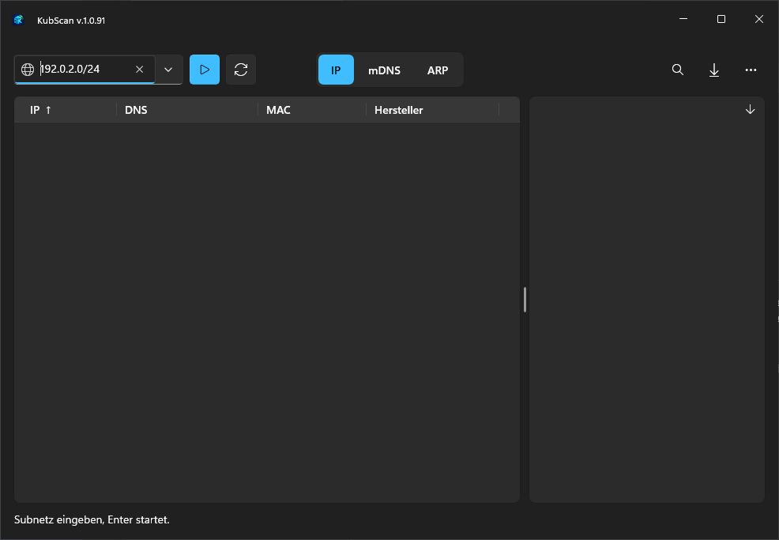
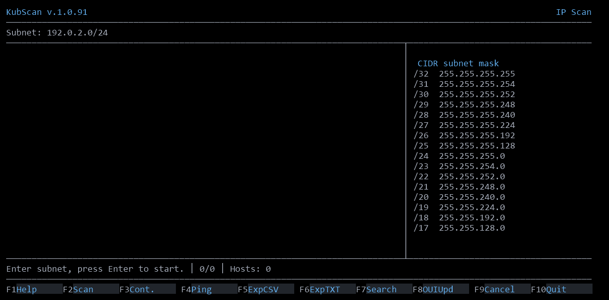

<p align="center">
  
</p>

<h1 align="center">KubScan für Windows</h1>

<p align="center">Geräte finden, lokale Dienste entdecken und ARP-Anfragen beobachten.</p>

<p align="center"><a href="https://github.com/nkxy1/KubScan-Windows/releases/latest"><strong>KubScan.exe herunterladen</strong></a></p>

## Schnellstart

1. Lade die portable `KubScan.exe` aus dem aktuellen Release herunter.
2. Öffne die EXE per Doppelklick für die **grafische Oberfläche**. Aus PowerShell oder CMD startet sie ohne Argumente oder mit `--tui` als **Terminaloberfläche** im selben Fenster.
3. Wähle **IP** und gib den Bereich deines Netzes ein, etwa `192.168.1.0/24`. Starte mit **Enter** oder **F2**. In der GUI kannst du auch auf den Startknopf klicken.

## Grafische Oberfläche



### IP-Geräte finden

Du kannst ein Subnetz wie `192.168.1.0/24`, einen Bereich wie `192.168.1.10-25` oder eine einzelne IPv4-Adresse eingeben. Bei einer einzelnen Adresse fragt die GUI nach der Netzmaske. Wähle `/32`, wenn du nur dieses eine Gerät prüfen willst. Über den Pfeil am Eingabefeld öffnest du den Verlauf der zuletzt oder häufig verwendeten Bereiche.

Die Ergebnisliste zeigt IP-Adresse, ermittelten Namen, MAC-Adresse und Hersteller, soweit verfügbar. Aktiviere für regelmäßige Wiederholungen den **Dauerscan** über den Kreispfeil oder **F3** und starte den Scan. KubScan markiert Änderungen, etwa neu gefundene oder ausgefallene Geräte. Mit **F9** stoppst du den laufenden Scan.

### mDNS-Dienste entdecken

Wähle **mDNS**, um lokal angekündigte Dienste zu finden. KubScan zeigt Dienstname, Typ, Host, Adresse und Port, soweit der Dienst diese meldet. Wähle einen Eintrag, um seine Details zu sehen. **F2** startet die Suche erneut oder stoppt sie, falls sie bereits läuft.

### ARP-Anfragen beobachten

Starte KubScan für diesen Modus **als Administrator**. Wähle **ARP** und den gewünschten Netzwerkadapter oder **Alle Adapter**. Die Tabelle zeigt beobachtete Anfragen mit Zeit, Adapter, Absender-IP, Absender-MAC und Ziel-IP. Mit **F2** startest oder stoppst du den Mitschnitt. Über **⋯ → Mitschnitt zurücksetzen** beginnst du mit einer leeren Liste. Der Mitschnitt benötigt eine Windows-Version mit PktMon-Streaming.

### Ergebnisse ansehen, prüfen und speichern

- **Filtern und sortieren.** Die Lupe oder **F7** öffnet die Suche. Ein Klick auf einen Spaltenkopf sortiert die Liste, ein weiterer kehrt die Reihenfolge um.
- **Details und Kopieren.** Wähle eine Ergebniszeile, um ihre Details zu sehen. Über den Pfeil im Detailbereich verschiebst du ihn nach rechts oder unter die Tabelle. Ein Rechtsklick auf eine Zelle bietet **Kopieren**.
- **Ports prüfen.** Rechtsklick auf ein IP-Ergebnis öffnet den vollständigen TCP-Portscan, den manuellen TCP-Portscan oder den UDP-Portscan. Bei manueller Auswahl sind Listen und Bereiche wie `22,80,443,8000-8010` möglich.
- **Verfügbarkeit und Betriebssystem prüfen.** **Dauerping** zeigt wiederholte Antworten und Laufzeiten eines Geräts. **Betriebssystem vermuten** liefert eine Einschätzung anhand verfügbarer Hinweise. Erkannte Verbindungen wie SSH, RDP oder Weboberflächen lassen sich aus dem Kontextmenü öffnen.
- **Exportieren.** Über das Download-Symbol speicherst du IP- und mDNS-Ergebnisse als CSV oder Textdatei.
- **Hilfe und Einstellungen.** **F1** öffnet die Hilfe. Unter **⋯** wechselst du Sprache und Design. In der IP-Ansicht kannst du dort die OUI-Datenbank für die Zuordnung von MAC-Präfixen zu Herstellern aktualisieren.

## Terminaloberfläche (TUI)



```powershell
.\KubScan.exe --tui
```

Gib das Subnetz oder den IP-Bereich oben ein. Die Menüleiste am unteren Rand zeigt die Aktionen des aktuellen Modus. Pfeil auf/ab wählt einen Treffer, Pfeil links/rechts die Sortierspalte. Bild auf/ab springt seitenweise. Mit **Leertaste** öffnest du Details, mit **C** kopierst du den Wert der gewählten Spalte in der IP- oder mDNS-Liste.

| Taste | Aktion |
| --- | --- |
| **F1** | Hilfe zum aktuellen Modus öffnen. In kleinen Fenstern mit den Pfeiltasten oder Bild auf/ab scrollen. |
| **F2** | IP-Scan starten, mDNS neu suchen oder den ARP-Mitschnitt starten bzw. fortsetzen. |
| **F3** | In der IP-Ansicht den Dauerscan starten oder stoppen. In ARP einen neuen Mitschnitt beginnen. |
| **F4** | In der IP-Ansicht den Dauerping für den gewählten Host öffnen. In ARP den Netzwerkadapter auswählen. |
| **F5 / F6** | IP-Ergebnisse als CSV oder TXT exportieren. |
| **F7** | In der aktuellen Ansicht suchen. **Enter** übernimmt den Filter. |
| **F8** | In der IP-Ansicht die OUI-Herstellerdatenbank aktualisieren. |
| **F9 / Esc** | Laufende Aktion stoppen. **Esc** schließt zunächst offene Details oder löscht den aktiven Filter. |
| **M / A** | Zwischen IP und mDNS bzw. zwischen IP und ARP wechseln. |
| **S / P / U / O** | Vollständiger TCP-Scan, manueller TCP-Scan, UDP-Scan oder Betriebssystem-Vermutung für den gewählten IP-Host. |
| **T / L** | Farbschema auswählen oder Deutsch und Englisch umschalten. |
| **F10** | KubScan beenden und zum Shell-Prompt zurückkehren. |

## Automatische Scans

Mit `scan` kannst du KubScan aus Skripten aufrufen. Ohne Exportoption werden die Ergebnisse im Terminal ausgegeben. `-csv` und `-txt` schreiben Dateien. Mit `-OutputPath` bestimmst du den Zielordner und mit `-Ports` die zu prüfenden TCP-Ports.

```powershell
.\KubScan.exe scan 127.0.0.1/32
.\KubScan.exe scan 192.168.1.0/24 -csv -txt -OutputPath .\Scanberichte -Ports "22,80,443"
```
